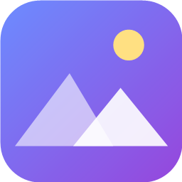

# Wallpaper Hub

Browse wallpapers from the web and set them with one click, or run **live (animated) wallpapers** behind your desktop icons on Windows. Works with multiple monitors.



## Download

Get the latest installer from the **[Releases page](../../releases/latest)** and run `Wallpaper-Hub-Setup-*.exe`.
A no-install `Wallpaper-Hub-Portable-*.exe` is there too.

> Windows may show **"Windows protected your PC"** because the app isn't code-signed. Click **More info**, then **Run anyway**.

## Features

- **Wallpapers:** search Wallhaven, Bing Daily, or the whole web (Bing Images). Filter by minimum resolution and aspect ratio. Favorites, timed auto-change, and a Refresh button that reshuffles the results.
- **Several monitors:** pick which screen a wallpaper goes on (or all of them). Still and live wallpapers are set per screen, and a game on one screen only pauses that screen.
- **Live wallpapers:**
  - 95 built-in animated scenes, including four **realistic** ones drawn with physically-inspired lighting (ocean sunset, above the clouds at sunrise, desert dunes, campfire at night) (black hole, cyberpunk street, deep ocean, a real-time solar system, Earth day and night, the real night sky, Moon phase, periodic table, molecules, DNA, Turing patterns, cinematic OLED and IPS sets, holiday scenes, Minecraft-style blocky worlds and a farm with animals and shader-style lighting, ...) with animated previews. **Category tabs** on the Live tab (Earth & Space, Realistic, Cinematic, Minecraft-style & Games, Holidays, Nature, Neon, Music, Clocks & PC, Science) plus one-click tabs for the downloadable videos (Anime, Games, Minecraft, Cars, Superhero, ...), and category chips on the Wallpapers tab.
  - **Earth in 3D** (two scenes): a real-time globe built from NASA pictures (Blue Marble day map, Black Marble city lights) with the real day and night line, the Sun with glare, and the real Moon (LRO map) where they are right now. A flat corner map shows where the Sun and Moon are overhead. Everything is bundled, so it works offline. Info text and labels are hidden by default on scenes where they are only extras; a switch (and a per-wallpaper choice) shows them.
  - **Graphics setting** (Eco / Balanced / High / Ultra) and **Screen type** (OLED / IPS) so the heavy scenes stay cool and quiet, and a **pause when a window is maximized** option. Three optional extras, all off until you turn them on: a **frame rate limit** (30 to 240 fps), **automatic switching** (drops to Eco on battery or when the graphics card is busy) and a **live readout** of what the wallpaper itself uses.
  - **Playlists:** pick the wallpapers you like and let them rotate on a timer (30 seconds to an hour, optional shuffle), with a separate list for each screen. **Match my screens** changes every screen at the same moment and pairs the wallpapers from each list that look most alike (by color), and you can choose which screen shows which list. Screens are remembered by their monitor model name, so your lists stay with the right screen even if Windows renumbers your displays after a restart. New wallpapers **fade in smoothly over the old one**, and the rotation waits while a game or fullscreen app has the wallpaper paused.
  - **Fuse two wallpapers:** blend two videos, GIFs or built-in scenes into one. Pick them in two big pictures (hover a picture for 5 seconds for a large preview, and a Swap button flips them), or press **Fuse** on any card. Choose how they combine: **merge them together** like one scene (the dark parts of one let the other shine through, with automatic color and brightness matching and a soft shared tone), through a shape (circle, heart, star, hexagon and more, which you can drag around in a small preview), or by the brightness of the first wallpaper. A black-hole style **warp** can bend either wallpaper all the time, in pulses, or at one moment of a video (for example when a curtain opens) and then settle back to normal. Fused wallpapers are saved with a picture of how they look. Effects fade in gently and the colors are matched, so it looks seamless.
  - **Styles tab:** lay a galaxy, black hole, nebula, aurora, waves or other animated layers over any wallpaper (or any fused one), tint its colors (rainbow, starry, fire and more), warp it, and keep the brightness right automatically. **Suggest a look** reads a wallpaper's colors and picks layers that suit it.
  - **Auto look for playlists:** each time a playlist or matched screens change wallpaper, the app can add styles and colors chosen for that wallpaper (a different style for each wallpaper and each screen), or fuse it with the most similar wallpaper in the same list. Off by default; your saved wallpapers are never changed.
  - **Performance tab settings** (like Wallpaper Engine's): choose what a fullscreen app does to the wallpaper (pause it, stop it completely to free video memory, keep playing but mute it, or keep playing), pause, mute or stop while chosen programs run (a separate action for each program), a "give games more CPU" low-priority option, pause when the PC is locked or on battery, and the graphics options (preset, frame rate limit, automatic switching, live readout). All optional.
  - **Desktop icons (Icon Fade, built in, off by default):** icons fade away while a live wallpaper (or any wallpaper) is showing, and only the one under your mouse appears. It reads icon positions from the desktop list that Explorer keeps, so some security programs may ask about it; its source is in `iconfade/`. It reacts in about 10 ms and uses about 1 MB of memory when idle. There is also "Hide completely (stronger)" and, for screens with HDR on, an experimental "Fully invisible" option that hides the icons completely and passes your clicks on to the desktop. Icons are always put back when you turn it off or quit, even if Wallpaper Hub is closed suddenly. If faint ghosts of the icons still show on a screen (for example with HDR), **Hide completely (stronger)** also makes the icon names black while hidden.
  - **Web page / HTML wallpapers:** use a web page or an HTML file as a wallpaper. It runs in a locked-down window (no camera, microphone, downloads or popups, and it cannot leave its site). Optional **pause on battery power**.
  - **Music-reactive scenes** (equalizer city, lasers, fireworks, galaxy, waves, ...) that move to whatever sound your PC is playing (system audio only). Two optional scenes (Voice Orb, Clap Lights) use your microphone only after you confirm; Cursor Magic follows your mouse.
  - **Live lyrics:** the words of the song you are playing (Spotify, YouTube, Apple Music, anything Windows shows as now playing), as a full wallpaper or over the music scenes. Optional, and it asks first.
  - **Notifications:** show the notifications of the apps you pick (Discord and more) as corner pop-ups on your live wallpaper, or as a full Notification Wall wallpaper, with a sound for each app or even each person. Needs Windows notifications turned on; optional, and it asks first.
  - **Discord calls:** notices when you are in a Discord call, pauses your music and video wallpapers (and resumes them afterwards), and shows an "On a Discord call" timer. A step-by-step setup in the Notifications tab checks itself as you go. A Pause button for live wallpapers is on the Live tab and in the tray.
  - **Customize tab:** change the look of the app itself (10 themes, your own colors, fonts, backgrounds, frosted glass, borders, shadows, glow, sidebar position and width, tab order, keyboard shortcuts, click sounds, your own CSS, saved looks that switch by time of day, a "Surprise me" button, and backup/restore to a file). For wallpapers: speed, colors, blur, sepia, black and white, zoom, move, rotate, flips, fit, color wash, vignette, film grain, scan lines, cinema bars, your own text, and start/stop times for videos, applied to every live wallpaper, to one wallpaper, to one screen, or on a time-of-day schedule. Still wallpapers get the same kind of effects (also per screen) and a choice of how Windows fits the picture.
  - **Editor tab:** build your own wallpaper from layers (scenes, videos, pictures, text, clock, gradients, shapes, style effects) with snapping guides, align buttons, undo/redo, copy and paste, drag to reorder, lock and rename layers, 6 starter templates, layers that only show at certain times of day, ultrawide shapes, saving to a file, and recovery of unsaved work. Creations stay on your PC.
  - **Colors:** brightness, contrast and color sliders that change your current wallpaper (live ones instantly).
  - **Clock & date on your wallpaper:** 15 styles (thin, neon, LCD, frosted glass, calendar tile, analog, progress rings, orbit dots, binary dots, word clock, progress bars, a centered spaced-weekday look and more). Pick 12-hour (4:36 PM) or 24-hour time, show seconds and the date, choose the color and size, and drag the clock to any spot on a preview of your screen. The spaced-weekday style uses the free Jost font (bundled, SIL Open Font License) and, if you have the Anurati font installed on your PC, uses that for the weekday and month. Anurati is free for personal use and is not bundled.
  - A **System Monitor** wallpaper showing live CPU, GPU, temperatures and memory.
  - A free video library (NASA and Wikimedia Commons) with category buttons.
  - **MotionBGs search** (motionbgs.com): thousands of free 4K/HD animated wallpapers (anime, games, Minecraft, cars, ...). Nothing is bundled; a wallpaper is downloaded only when you click Apply. Every download is checked before use: it must come from motionbgs.com, be a real MP4/WebM video under 60 MB with a valid structure, and pass a Windows Defender scan (when Defender is available); anything else is deleted. Videos play in a sandboxed window with no access to your files. The artwork belongs to its creators and is for personal use.
  - Your own MP4/WebM/GIF files (drag and drop, or paste a link), YouTube videos and playlists (with Next and Shuffle), and Pexels stock videos (free API key).
  - Volume control, resolution, sharpness (smooth, normal, sharp) and picture-fit settings that also work on GIFs and videos, pauses while a game or fullscreen app is focused (optionally on every screen, since a game needs the whole graphics card), runs from the tray, optional start with Windows.
- **GIFs tab:** use any animated GIF as a wallpaper. Add your own, or browse free GIFs (Wikimedia Commons, or Giphy with your own free key).
- **Music tab:** play your own audio files and folders, YouTube links, or free internet radio stations in the background, with any wallpaper.
- **Performance tab and overlay:** live CPU, graphics card, memory, disk and network, plus GPU temperature (NVIDIA). An optional small always-on-top overlay (Ctrl+Shift+P) for games. CPU temperature and game FPS appear when HWiNFO / RivaTuner are running; the app installs no drivers.
- **Update notice:** tells you when a newer version is published here on GitHub.

**Light on memory:** with Wallpaper Hub living in the tray, the main window is not kept in memory, and each live wallpaper runs as few helper processes as possible.

## Credits

The Earth and Moon scenes use NASA imagery: Blue Marble and Black Marble (NASA Earth Observatory / NASA Goddard Space Flight Center) and the Moon maps from the Lunar Reconnaissance Orbiter (NASA/GSFC/Arizona State University, NASA Scientific Visualization Studio). NASA media are not copyrighted; credit is given here and in the scene names.

## Privacy

No accounts, no analytics, no telemetry. The app only contacts the sites it needs (Wallhaven, Bing, NASA, Wikimedia, MotionBGS, YouTube, SomaFM radio, GitHub for the update check, and Pexels or Giphy if you add a key). Only if you turn them on: Live Lyrics sends the song title and artist (never audio) to lrclib.net, and the Space Station scene asks wheretheiss.at for its position. Microphone scenes analyse sound on your PC and never record or send it. Notifications are read from the list Windows keeps on your PC and never leave it. Everything is stored on your PC.

## Build from source

```
npm install
npm start        # run
npm run dist     # build installer + portable exe into dist/
```

Requires Node.js. Windows only. `tools-genpreview.js` regenerates the scene preview clips in `build/previews/`.
